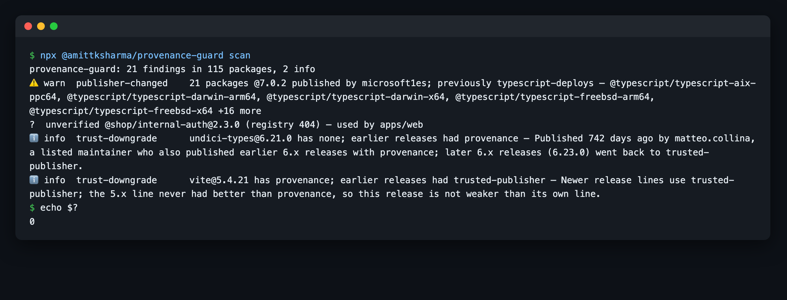
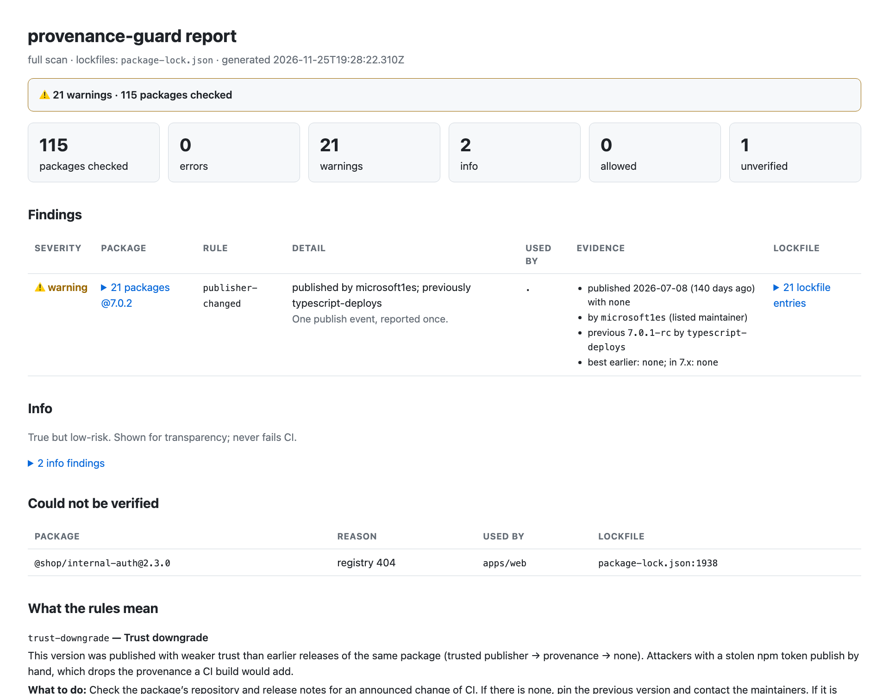

# provenance-guard

**Catch compromised npm releases before they reach your build.**

Most npm supply-chain attacks follow one pattern: an attacker steals a maintainer's token and publishes a new patch version by hand. Vulnerability scanners can't see it on day 0, because no advisory exists yet. But the registry shows what changed. The release lost the provenance its predecessors had, was built from a different repository, suddenly runs an install script, or comes from a different account.

provenance-guard compares every dependency update with **the package's own history** and fails CI when trust goes down.

- Works with **npm, pnpm and Yarn** (v1 and Berry), including **monorepos** (Nx, Turborepo, Lerna, workspaces)
- Reports as **text, JSON, Markdown, SARIF, JUnit and HTML**: GitHub code scanning, the Azure DevOps Tests and Scans tabs, PR summaries
- **Low noise:** related findings are grouped, low-risk ones are explained instead of failing the build, and nothing is hidden
- **Small and safe to run:** one runtime dependency, no install scripts, reads only public registry data



---

## Quick start

```bash
# In a pull request: check only what changed since main
npx @amittksharma/provenance-guard diff --base origin/main

# Audit everything in the lockfile
npx @amittksharma/provenance-guard scan
```

| Exit code | Meaning                                                                                                         |
| --------- | --------------------------------------------------------------------------------------------------------------- |
| `0`       | No errors                                                                                                       |
| `1`       | At least one error: don't merge until it's reviewed                                                             |
| `2`       | The check couldn't run (no lockfile, bad config, registry unreachable). It never passes when it couldn't finish |

## What it checks

| Rule                   | Fires when                                                                                         | Severity   |
| ---------------------- | -------------------------------------------------------------------------------------------------- | ---------- |
| `trust-downgrade`      | A release has weaker publishing trust than earlier releases: trusted publisher → provenance → none | ❌ error   |
| `source-repo-changed`  | Provenance says it was built from a different repository than before                               | ❌ error   |
| `install-script-added` | A release adds a `preinstall` / `install` / `postinstall` script the previous one didn't have      | ⚠️ warning |
| `publisher-changed`    | A release was published by hand from a different npm account                                       | ⚠️ warning |

Findings that are true but low-risk, such as an old maintenance release or a maintainer's own historical gap, are reported as **ℹ️ info** with the reason, and never fail CI. Findings from one publish event (for example a framework and its 20 platform packages) show as **one row**. Details: [How it works](https://github.com/amittkSharma/provenance-guard/blob/main/docs/how-it-works.md).

## Add it to CI

### GitHub Actions

```yaml
name: dependency trust
on: pull_request

jobs:
  provenance-guard:
    runs-on: ubuntu-latest
    steps:
      - uses: actions/checkout@v4
        with:
          fetch-depth: 0 # diff needs the base branch
      - uses: actions/setup-node@v4
        with:
          node-version: 22
      - run: >
          npx @amittksharma/provenance-guard diff --base origin/${{ github.base_ref }}
          --format markdown >> "$GITHUB_STEP_SUMMARY"
```

To show findings in GitHub code scanning, add `--output sarif=provenance-guard.sarif` and upload the file with `github/codeql-action/upload-sarif`.

### Azure DevOps

```yaml
steps:
  - checkout: self
    fetchDepth: 0
  - task: NodeTool@0
    inputs:
      versionSpec: "22.x"
  - script: >
      npx @amittksharma/provenance-guard diff --base origin/main
      --output junit=$(Build.ArtifactStagingDirectory)/provenance-guard.xml
      --output sarif=$(Build.ArtifactStagingDirectory)/CodeAnalysisLogs/provenance-guard.sarif
      --output html=$(Build.ArtifactStagingDirectory)/report/provenance-guard.html
  - task: PublishTestResults@2 # → Tests tab
    condition: always()
    inputs:
      testResultsFormat: JUnit
      testResultsFiles: $(Build.ArtifactStagingDirectory)/provenance-guard.xml
  - task: PublishBuildArtifacts@1 # → Scans tab (needs the free "SARIF SAST Scans Tab" extension)
    condition: always()
    inputs:
      PathtoPublish: $(Build.ArtifactStagingDirectory)/CodeAnalysisLogs
      ArtifactName: CodeAnalysisLogs
  - task: PublishBuildArtifacts@1 # → downloadable HTML report
    condition: always()
    inputs:
      PathtoPublish: $(Build.ArtifactStagingDirectory)/report
      ArtifactName: provenance-guard-report
```

For pull requests, replace `origin/main` with your target branch.

### Any other CI

```bash
git fetch origin main
npx @amittksharma/provenance-guard diff --base origin/main --output html=provenance-guard.html
```

## Reports

`--format <name>` chooses what is printed to the terminal. `--output <name>=<file>` writes a report file, and you can repeat it. All reports come from one check, so extra formats don't make extra registry requests.

| Format     | Best for                                                                                                                                                              |
| ---------- | --------------------------------------------------------------------------------------------------------------------------------------------------------------------- |
| `text`     | Terminals (default)                                                                                                                                                   |
| `markdown` | PR comments and CI step summaries                                                                                                                                     |
| `html`     | Sharing with people outside CI. One self-contained file ([example](https://github.com/amittkSharma/provenance-guard/blob/main/docs/examples/report.html))             |
| `sarif`    | GitHub code scanning, the Azure DevOps Scans tab, any SARIF viewer ([example](https://github.com/amittkSharma/provenance-guard/blob/main/docs/examples/report.sarif)) |
| `junit`    | The Azure DevOps Tests tab, Jenkins, GitLab                                                                                                                           |
| `json`     | Scripts and dashboards                                                                                                                                                |

### HTML report



Each finding shows the package, the rule, which workspaces use it, the evidence (publisher, maintainer status, release age, previous version) and where it sits in the lockfile. Info and allowed findings are collapsed below, each with its reason.

### Markdown (PR summary)

```markdown
### provenance-guard

| Severity | Package                                                                                                   | Rule                | Detail                                                   | Used by |
| -------- | --------------------------------------------------------------------------------------------------------- | ------------------- | -------------------------------------------------------- | ------- |
| ⚠️ warn  | 21 packages: `@typescript/typescript-aix-ppc64`, `@typescript/typescript-darwin-arm64`, … +16 more @7.0.2 | `publisher-changed` | published by microsoft1es; previously typescript-deploys | `.`     |

115 packages checked.

<details><summary>2 info findings</summary> … </details>
<details><summary>1 package could not be verified</summary> … </details>
```

### JSON

```json
{
  "checked": 115,
  "findings": [
    {
      "rule": "trust-downgrade",
      "severity": "info",
      "name": "vite",
      "version": "5.4.21",
      "message": "vite@5.4.21 has provenance; earlier releases had trusted-publisher",
      "context": "Newer release lines use trusted-publisher; the 5.x line never had better than provenance, …",
      "usedBy": ["packages/ui"],
      "locations": [{ "file": "package-lock.json", "line": 1433 }],
      "evidence": { "publisher": "vitebot", "publisherIsMaintainer": true, "ageDays": 401, "line": "5.x" }
    }
  ],
  "groups": [],
  "suppressed": [],
  "unverified": [],
  "warnings": [],
  "notes": []
}
```

## Configure

Optional. Put a `.provenance-guard.json` in your project root:

```jsonc
{
  "base": "origin/main", // default branch or commit for `diff`
  "recursive": true, // check every lockfile in a monorepo
  "exclude": ["test/fixtures"], // folders whose lockfiles to ignore
  "rules": {
    "publisher-changed": "info" // "error" | "warn" | "info" | "off"
  },
  "allow": [
    {
      "name": "some-package",
      "rule": "trust-downgrade",
      "version": "1.2.3", // optional: only this version
      "reason": "Maintainers moved CI, confirmed in their issue #42"
    }
  ]
}
```

- **`allow`**: accept a finding you've reviewed. A **reason is required**, and allowed findings still appear in every report as "allowed", so exceptions stay visible.
- Command-line flags override the file: `--base`, `--lockfile`, `--recursive`, `--config`, `--registry`, `--format`, `--output`.

## Use it from code

```ts
import { check, render } from '@amittksharma/provenance-guard';

const result = await check({
  cwd: '/path/to/project',
  base: 'origin/main', // omit to check the whole lockfile
  rules: { 'publisher-changed': 'info' },
});

console.log(render('markdown', result)); // 'text' | 'json' | 'markdown' | 'sarif' | 'junit' | 'html'
process.exitCode = result.exitCode; // 0 or 1
```

| Option                               | Default        | Purpose                                                        |
| ------------------------------------ | -------------- | -------------------------------------------------------------- |
| `cwd`                                | current folder | Project folder                                                 |
| `base`                               | —              | Git branch or commit to compare with. Unset: check everything  |
| `lockfile` / `recursive` / `exclude` | auto-detect    | Which lockfiles to check                                       |
| `rules` / `allow`                    | —              | Severity overrides and accepted findings                       |
| `registry` / `headers`               | npmjs.org      | Registry URL and extra headers (for example auth for a mirror) |
| `fetchJson`                          | built-in       | Your own HTTP function (proxies, caching, tests)               |

`check()` throws when it can't finish. Catch the error and fail your job.

## Monorepos

Run it from the repository root. Each finding lists the workspaces that use the package:

```text
❌ error trust-downgrade  debug@4.4.2 has none; earlier releases had provenance — used by apps/web, packages/ui
```

If there are other lockfiles below the root, the report says so. Add `--recursive` to check them all.

## When it finds something

1. **Look at the package:** its npm page, repository and recent issues. Was the change announced (new CI, new maintainer, moved repo)?
2. **Not explained?** Don't merge. Pin the previous version and tell the maintainers.
3. **Explained?** Add an `allow` entry with the version and the reason.

Also turn on your package manager's release-age gate (npm `min-release-age`, pnpm `minimumReleaseAge`, Yarn `npmMinimalAgeGate`). It delays brand-new versions while the community spots attacks.

## Troubleshooting

| Problem                                  | Fix                                                                                                              |
| ---------------------------------------- | ---------------------------------------------------------------------------------------------------------------- |
| `unable to get local issuer certificate` | Corporate proxy. Node ≥ 22.15: `NODE_OPTIONS=--use-system-ca`. Older Node: `NODE_EXTRA_CA_CERTS=/path/to/ca.pem` |
| `git show origin/main:… failed`          | Shallow clone: use `fetch-depth: 0` or `git fetch origin main`                                                   |
| `HTTP 401` / `HTTP 403`                  | `npx` picked up your private registry. Add `--registry https://registry.npmjs.org`                               |
| A private package is "unverified"        | Expected: it isn't on the public registry                                                                        |

## Learn more

- [A story: the lockfile that never lies](https://github.com/amittkSharma/provenance-guard/blob/main/docs/story.md): a walkthrough of a team adopting it, including a fire drill
- [How it works](https://github.com/amittkSharma/provenance-guard/blob/main/docs/how-it-works.md): severity rules, grouping, monorepos, report formats, limits
- [Rules roadmap](https://github.com/amittkSharma/provenance-guard/blob/main/docs/rules-roadmap.md): planned rules and how to add one
- [Background](https://github.com/amittkSharma/provenance-guard/blob/main/docs/background.md): the attacks this targets and what other tools miss
- [Architecture](https://github.com/amittkSharma/provenance-guard/blob/main/docs/architecture.md): code structure, for contributors

## Contributing

```bash
npm install     # also sets up the git hooks
npm test        # needs Node ≥ 22.18
npm run lint:fix && npm run types
```

Commits follow [Conventional Commits](https://www.conventionalcommits.org) (`feat: …`, `fix: …`). Releases are published from GitHub Actions with npm trusted publishing, so every version carries provenance.

## License

MIT
