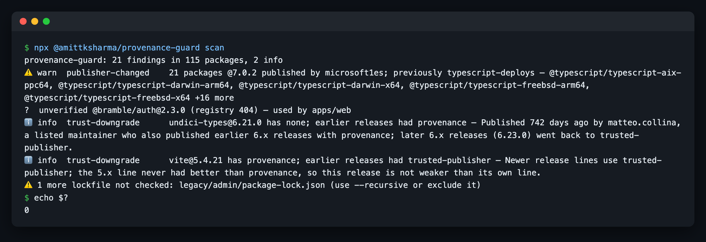
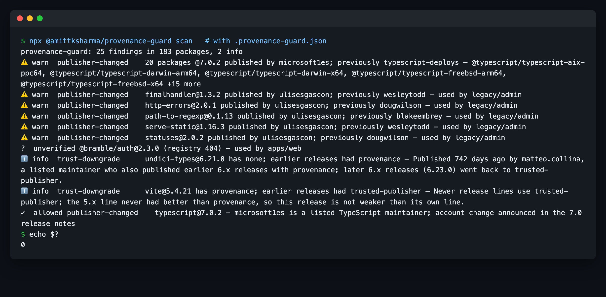
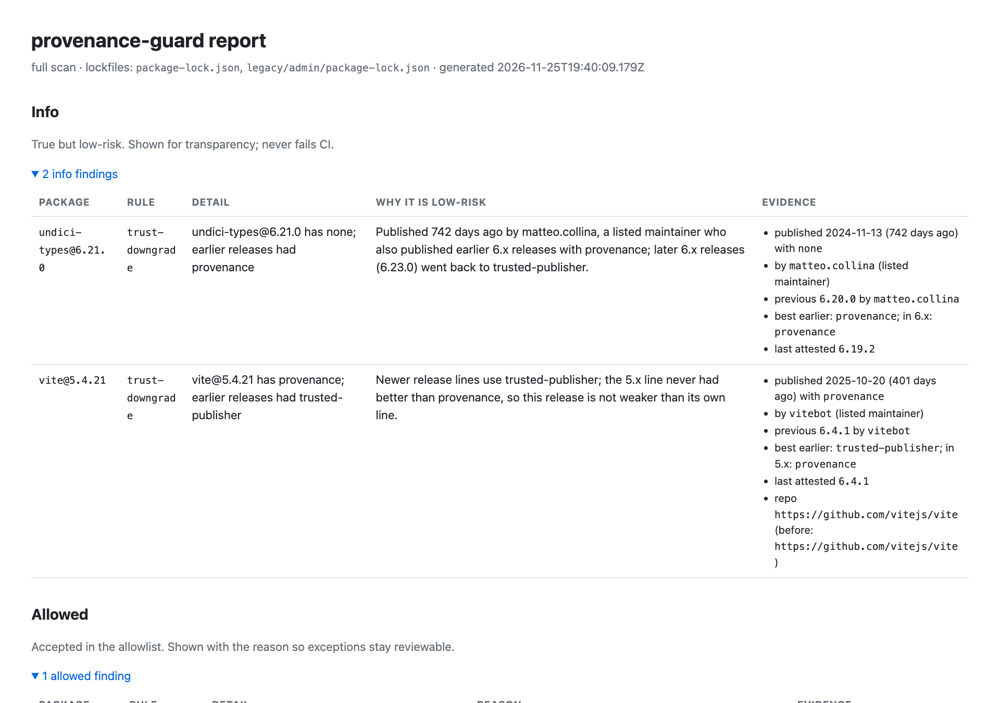
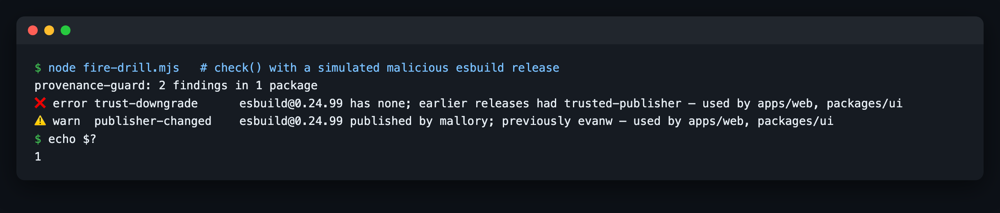
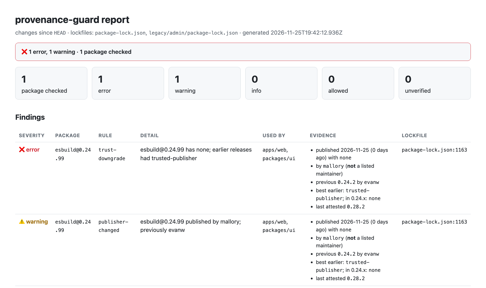

# The lockfile that never lies (but rarely talks)

_A short story about provenance-guard, a monorepo, and a fire drill with a suspicious name in it._

All terminal output and reports below come from real runs against the public npm registry. The one exception is the fire drill in Part 6, which is simulated, and says so.

---

## Part 1: Friday, 4:52 pm

Bramble & Co. builds a shop. The code lives in one monorepo:

```
bramble/
├── apps/web          the storefront (React)
├── packages/ui       the shared component library (Vite, esbuild)
└── legacy/admin      the old Express back office nobody wants to touch, with its own lockfile
```

Every Friday a dependency-update pull request arrives: 214 changed lines in `package-lock.json`. Sam, the platform engineer, opens it, scrolls the way people scroll through terms and conditions, sees that `npm audit` is green, and clicks **Merge**.

`npm audit` is a good tool. It is also a smoke detector that only beeps once the fire department has published a report about your fire. On the day a package is compromised, there is no report yet.

Sam knew how the big npm incidents had gone:

- **Nx "s1ngularity" (2025):** malicious versions were published with a stolen token. The legitimate releases had provenance from CI; the malicious ones had none.
- **Shai-Hulud (2025):** a worm used stolen tokens to republish packages with a brand-new install script.
- **ua-parser-js and coa/rc (2021):** hijacked accounts added install scripts that ran on every `npm install`.

In every case the npm registry itself showed that something had changed, hours before any advisory existed. Nobody was looking.

## Part 2: The gap, and the napkin

Sam listed what already existed:

| Tool                                 | What it does                                 | What it misses                                                      |
| ------------------------------------ | -------------------------------------------- | ------------------------------------------------------------------- |
| `npm audit`, OSV                     | Known vulnerabilities                        | Day-0 attacks: there is no advisory yet                             |
| npm, pnpm and Yarn release-age gates | Delay brand-new versions                     | Not a trust check. Says nothing about _how_ a version was published |
| pnpm `trustPolicy`                   | Blocks provenance downgrades at install time | pnpm only, blocks silently, nothing to show a reviewer              |
| Commercial supply-chain platforms    | All of it                                    | A paid SaaS, a vendor review, and a procurement form                |

Then Sam did the napkin maths for building it in-house:

| Piece of work                                                                                                   | Rough estimate                                           |
| --------------------------------------------------------------------------------------------------------------- | -------------------------------------------------------- |
| Parse npm, pnpm (v6 and v9), Yarn v1 and Yarn Berry lockfiles, including aliases and workspaces                 | 1 week                                                   |
| Fetch each package's history, decode SLSA provenance attestations, handle private registries, 401s and timeouts | 1 week                                                   |
| Rules that don't drown everyone in false alarms                                                                 | 1–2 weeks, plus forever                                  |
| Monorepo attribution ("which app uses this?")                                                                   | 3–4 days                                                 |
| Reports for GitHub, Azure DevOps, humans and auditors                                                           | 1 week                                                   |
| **Total**                                                                                                       | **about 4–6 weeks for one engineer**, before maintenance |

The napkin went in the bin. Sam ran one command instead.

## Part 3: The first run

```bash
npx @amittksharma/provenance-guard scan
```



Sam was braced for fireworks. What came back read more like a polite memo:

- **One warning row standing for 21 packages.** TypeScript 7.0.2 and its 20 platform packages were published by `microsoft1es` instead of `typescript-deploys`. One publish event, reported once instead of 21 times.
- **Two ℹ️ info findings, each with its reason.** `vite@5.4.21` is a maintenance release whose own release line never had stronger publishing. `undici-types@6.21.0` is a real, 742-day-old gap left by a maintainer who later went back to trusted publishing. Both are true, neither is an emergency, and neither fails CI.
- **`@bramble/auth` could not be verified:** it's Bramble's private package, so the public registry returned 404. That's expected, and it's listed rather than silently skipped.
- **"1 more lockfile not checked: legacy/admin/package-lock.json."** The tool had noticed the back office's separate lockfile, the one that is easy to forget.

Exit code `0`. Sam had expected to spend Friday evening reading output. It took four minutes.

## Part 4: Triage, in one file

Jo, the security lead, checked the TypeScript change: `microsoft1es` is a listed TypeScript maintainer. They wrote it down where it would be reviewed like any other code:

```jsonc
// .provenance-guard.json
{
  "recursive": true, // check legacy/admin too
  "allow": [
    {
      "name": "typescript",
      "rule": "publisher-changed",
      "version": "7.0.2",
      "reason": "microsoft1es is a listed TypeScript maintainer; account change announced in the 7.0 release notes"
    }
  ]
}
```



The new scan covered **183 packages across both lockfiles**. Three things stood out:

- **The allowed finding didn't disappear.** It's listed as `✓ allowed` with Jo's reason, so the exception stays visible in every report. A suppression nobody can see is a suppression nobody can review.
- **`legacy/admin` showed five Express dependencies** newly published by `ulisesgascon`, an Express maintainer. Each finding names the workspace that uses the package (`used by legacy/admin`), so the right people get the question.
- **Two honest rough edges.** The allowlist works per package, so accepting all 20 TypeScript platform packages would take 20 entries. And the five Express findings aren't grouped, because each has a different version and previous publisher. Both are noted for future releases. Today they cost Jo about a minute.

The HTML report keeps the low-risk material one click away, with the evidence beside each item:



## Part 5: Wiring it into CI

Rafa, who maintains the pipelines, added it in two places.

**GitHub, for pull requests.** A Markdown summary appears on every run:

```yaml
- run: >
    npx @amittksharma/provenance-guard diff --base origin/${{ github.base_ref }}
    --format markdown >> "$GITHUB_STEP_SUMMARY"
```

**Azure DevOps, for the release pipeline.** One check writes every format:

```yaml
- script: >
    npx @amittksharma/provenance-guard diff --base origin/main
    --output junit=$(Build.ArtifactStagingDirectory)/provenance-guard.xml
    --output sarif=$(Build.ArtifactStagingDirectory)/CodeAnalysisLogs/provenance-guard.sarif
    --output html=$(Build.ArtifactStagingDirectory)/report/provenance-guard.html
```

- **JUnit** goes to the **Tests** tab: errors are failed tests, warnings are skipped with the reason.
- **SARIF** goes to the **Scans** tab, through the free SARIF SAST Scans Tab extension.
- **HTML** is a downloadable artifact for anyone without pipeline access.

"Three formats means three times the registry calls, right?" asked Rafa. No. Every report is rendered from the same single check.

## Part 6: The fire drill

Jo doesn't trust a smoke detector until they've lit a match under it. They wrote a fire drill with the API, using the real registry data plus one fake release. `esbuild` normally publishes through trusted publishing, so the drill invents `esbuild@0.24.99`, published by hand by an account called `mallory`. (In security writing, nobody called Mallory has ever done anything innocent.)

```js
// fire-drill.mjs (simulation: real registry data plus one fake release)
import { check, render, createFetchJson } from '@amittksharma/provenance-guard';

const real = createFetchJson();
const fetchJson = async (url) => {
  const res = await real(url);
  if (url.endsWith('/esbuild') && res.status === 200) {
    res.body.versions['0.24.99'] = {
      ...res.body.versions['0.24.2'],
      version: '0.24.99',
      _npmUser: { name: 'mallory' },
      dist: {},
    };
    res.body.time['0.24.99'] = new Date().toISOString();
  }
  return res;
};

// The lockfile in the working tree now says esbuild 0.24.99; HEAD still has 0.24.2.
const result = await check({ base: 'HEAD', recursive: true, fetchJson });
console.log(render('text', result));
process.exitCode = result.exitCode;
```



Exit code `1`. The build fails, and the report says why:



- **`trust-downgrade`, error:** esbuild's earlier releases used trusted publishing, and this one has none, a recent hand-published patch on an old release line. That's exactly what a stolen token produces, so it is rated an error, not info.
- **`publisher-changed`, warning:** `mallory`, **not** a listed maintainer, where the previous release came from `evanw`.
- **`used by apps/web, packages/ui`:** esbuild is a dependency of `packages/ui`, and `apps/web` gets it through that workspace. Both teams know it concerns them.

The same finding in the other formats:

**Markdown** (PR summary):

```markdown
| Severity | Package           | Rule                | Detail                                                           | Used by                   |
| -------- | ----------------- | ------------------- | ---------------------------------------------------------------- | ------------------------- |
| ❌ error | `esbuild@0.24.99` | `trust-downgrade`   | esbuild@0.24.99 has none; earlier releases had trusted-publisher | `apps/web`, `packages/ui` |
| ⚠️ warn  | `esbuild@0.24.99` | `publisher-changed` | esbuild@0.24.99 published by mallory; previously evanw           | `apps/web`, `packages/ui` |
```

**JUnit** (Azure DevOps Tests tab):

```xml
<testcase classname="provenance-guard.trust-downgrade" name="esbuild@0.24.99">
  <failure message="esbuild@0.24.99 has none; earlier releases had trusted-publisher" type="trust-downgrade">…
Used by: apps/web, packages/ui
Location: package-lock.json:1163</failure>
</testcase>
```

**SARIF** (code scanning). Clicking the alert opens line 1163 of the lockfile:

```json
{
  "ruleId": "trust-downgrade",
  "level": "error",
  "message": { "text": "esbuild@0.24.99 has none; earlier releases had trusted-publisher" },
  "locations": [
    { "physicalLocation": { "artifactLocation": { "uri": "package-lock.json" }, "region": { "startLine": 1163 } } }
  ],
  "properties": {
    "usedBy": ["apps/web", "packages/ui"],
    "evidence": {
      "publisher": "mallory",
      "publisherIsMaintainer": false,
      "ageDays": 0,
      "line": "0.24.x",
      "bestEarlierTrust": "trusted-publisher"
    }
  }
}
```

The drill also caught a bug _in provenance-guard itself_: the first version of the HTML said the fake release was published "-1 days ago", because the simulated timestamp was a few milliseconds newer than the check's clock. Ages are now never negative. Even fire drills are better with a second fire drill.

## Part 7: Making it theirs

Bramble wanted a Slack message, not another dashboard. The API took a few lines:

```ts
import { check, render } from '@amittksharma/provenance-guard';

const result = await check({
  base: 'origin/main',
  recursive: true,
  rules: { 'publisher-changed': 'warn' }, // severities are configurable: error | warn | info | off
});

if (result.exitCode === 1) {
  await postToSlack('#security', render('markdown', result));
}
```

Things they came to rely on:

- **It never passes silently.** No lockfile, a bad config, or the registry returning 401, 429 or 5xx gives exit code `2` with the reason, never a green tick.
- **Behind the corporate proxy,** Node needed `NODE_OPTIONS=--use-system-ca`. It's one line in the pipeline.
- **One runtime dependency and no install scripts.** A supply-chain tool with a long supply chain would be a punchline.

## Part 8: What it doesn't do

Jo insisted this part be included.

- **A maintainer's own phished account injecting code into an existing file**, with no install script and no provenance to lose (the chalk/debug pattern, September 2025), isn't caught by today's rules. Bramble also turned on their package manager's release-age gate, which is the practical defence until a code-diff rule exists ([rules roadmap](rules-roadmap.md)).
- **An attacker who controls the project's own CI _and_ a maintainer's identity** produces a release that looks legitimate. Code review and the release-age gate cover that case.
- **Recall on real incidents can't be replayed:** the real malicious versions were removed from npm. The rules are tested against simulated attacks like the drill above.

## Epilogue: Friday, 4:58 pm

The dependency pull request still arrives every Friday. Now it carries a summary at the top. Usually it says `✅ 37 packages checked, no trust regressions`, and Sam merges it with the same click as before, except now the click means something.

| Before                                     | After                                                         |
| ------------------------------------------ | ------------------------------------------------------------- |
| "`npm audit` is green" stood in for "safe" | Every update compared with the package's own history          |
| 214 lockfile lines, unread                 | One summary: grouped, explained, attributed to the owning app |
| A forgotten second lockfile                | Found automatically, and `--recursive` checks it              |
| An estimated 4–6 weeks to build in-house   | One `npx` command and a 10-line config                        |
| Exceptions in someone's head               | Exceptions in Git, with reasons, visible in every report      |

---

**Try it:**

```bash
npx @amittksharma/provenance-guard scan
```

More: [README](../README.md) · [How it works](how-it-works.md) · [Rules roadmap](rules-roadmap.md)
